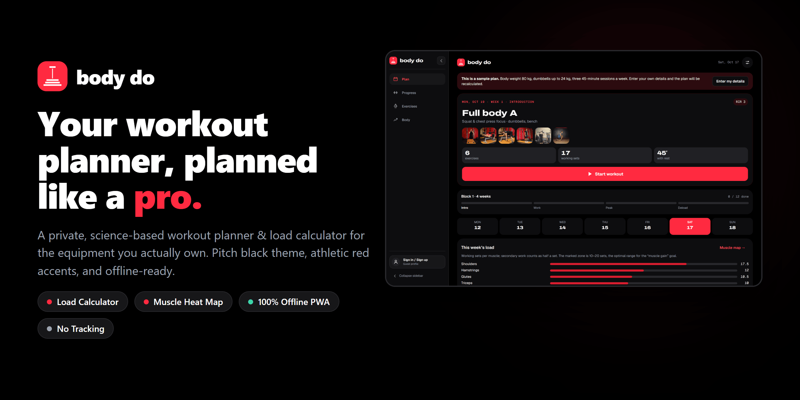
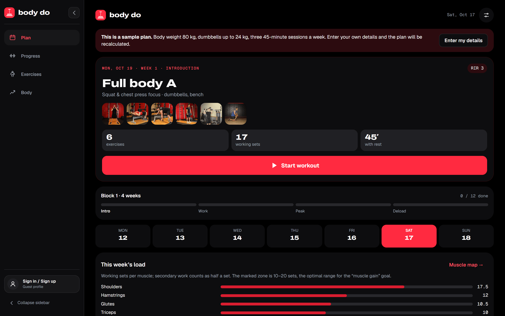
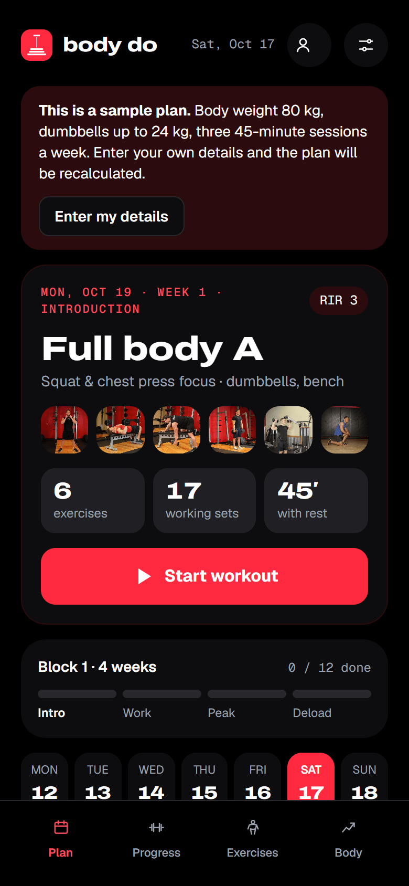
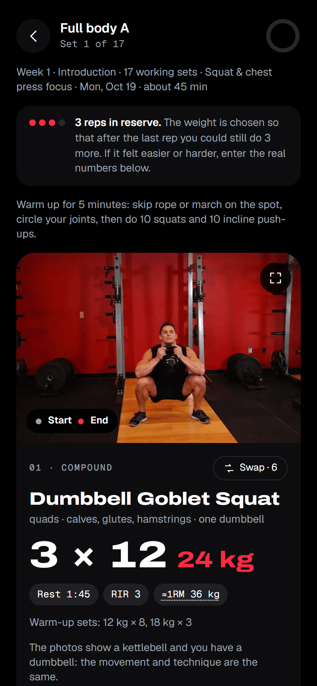
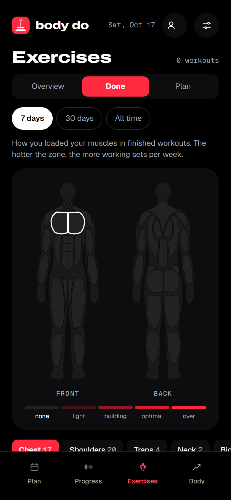
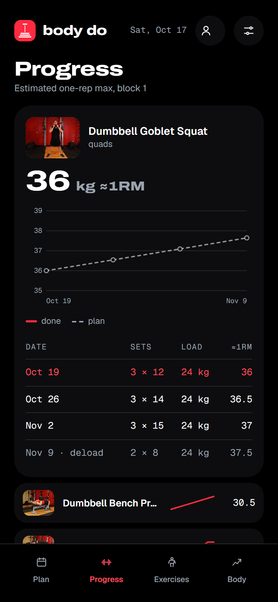
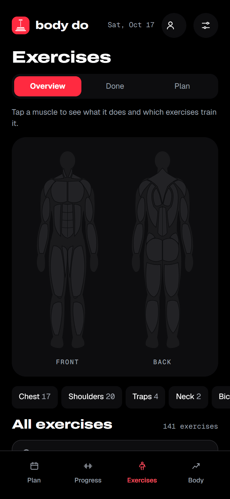
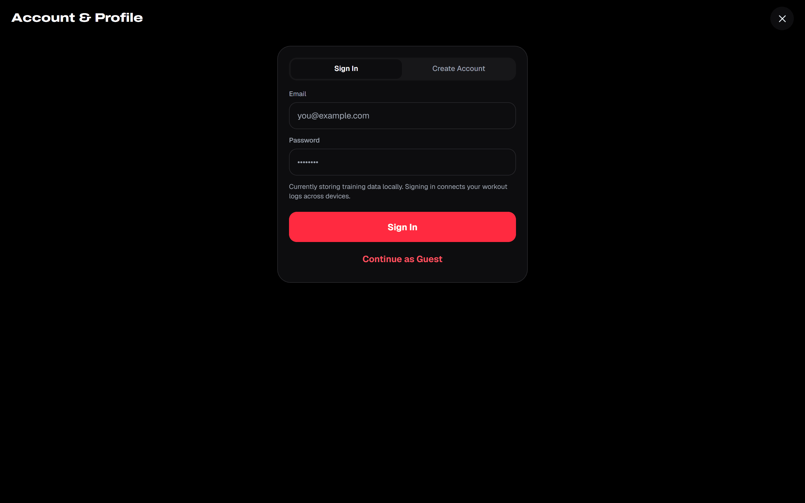

Ref: KL-7Q4

<div align="center">
  
  <h1>Body Do</h1>
  <p><strong>Your workout planner, planned like a pro.</strong></p>
  <p>
    A workout planner and load calculator for the equipment you actually own.<br>
    Pure black & athletic red theme, offline-first, no tracking. Your data stays on your device.
  </p>
</div>

<picture>
  <source media="(prefers-color-scheme: dark)" srcset="docs/assets/hero-dark.png">
  
</picture>

Body Do builds a personalized training plan from your schedule and equipment, tells you how much to lift in
every set, and adjusts the numbers as you log your sessions. It is science-based, runs entirely in
the browser, and can be installed as an offline progressive web app (PWA).

## Desktop Dashboard

<p align="center">
  
</p>

## Mobile Screenshots

<table>
  <tr>
    <td width="33%"></td>
    <td width="33%"></td>
    <td width="33%"></td>
  </tr>
  <tr>
    <td width="33%"></td>
    <td width="33%"></td>
    <td width="33%"></td>
  </tr>
</table>

**Modern UI & Design**

- **Pitch Black & Athletic Red Theme:** Pure OLED black backgrounds (`#000000`), dark surfaces, and energetic red accents (`#ff2a40`).
- **Collapsible Sidebar:** Flexible desktop navigation with one-click expand/collapse and saved user preference.
- **Account & Profile Modal:** Quick-access sign in / sign up and guest mode directly from the sidebar.
- **Spacious Dashboard Layout:** Generous `82rem` content layout that takes full advantage of wide desktop monitors.
- **Custom Dumbbell Branding:** Signature vertical dumbbell iconography across the app, splash screen, and PWA icons.

**Planning**

- Full body, upper/lower or push/pull/legs, chosen from the days you train.
- Sessions fitted to your time budget, from 20 to 120 minutes.
- Only exercises you can do with your equipment: 12 kinds, from nothing at all to a barbell rack.
- Four-week blocks with a deload week; the next block continues from the level you reached.
- Missed a session? Do it today and the rest of the plan shifts with it, or skip it.

**Load calculator**

- Starting weights from body weight, experience, sex and age, picked from the weights you own.
- Progression driven by estimated one-rep max (e1RM) and reps in reserve (RIR).
- Edit any set or rate how it felt, and every later session is recalculated.
- Warm-up sets and a plate breakdown for barbells.

**Workout**

- One card per exercise with start and end photos, technique, sets, reps and load.
- Set tracker with a rest timer that names what comes next, beeps and vibrates.
- Swap an exercise for an alternative that trains the same muscles, by hand or at random.
- The screen stays awake while you train.

**Exercises & Muscle Map**

- Front and back interactive body map with 17 muscle groups: tap a muscle to see target exercises.
- Weekly volume as an intensity heat map, planned or actually performed, rated against your goal.
- Catalog of 141 exercises under the map, with search, filters and three levels of detail.

**Body Measurements**

- Weight, six girths, BMI and body fat estimated with the US Navy circumference method.
- Charts for every metric and a journal.
- Progress photos by pose with side-by-side comparison.

**Privacy & Offline-First**

- No analytics, no third-party trackers: even fonts are bundled locally.
- Everything is stored directly in your browser with IndexedDB and single-file backup/restore.
- Installable progressive web app (PWA) that runs completely offline.
- English and Russian support with dark theme by default.

## Quick start

You need [Node.js](https://nodejs.org) 24, [pnpm](https://pnpm.io) 10 and `make`.

```sh
pnpm install
pnpm dev          # http://localhost:5173
```

Or with Docker, without Node on the host:

```sh
make docker-run   # production image on http://localhost:8080
make docker-dev   # dev server with hot reload on http://localhost:5173
make docker-stop
```

Run `make` to list every target. `make check` runs what CI runs: lint, typecheck, dataset
validation, unit tests and the production build. `make e2e` runs the Playwright tests.

## How it works

The short version; [docs/TRAINING_SCIENCE.md](docs/TRAINING_SCIENCE.md) has every rule and formula.

**Effort is prescribed as reps in reserve (RIR)**: how many more reps you could have done at the
end of a set. A four-week block goes 3 → 2 → 1 RIR and then deloads.

**Strength is tracked as an estimated one-rep max**, using the Epley formula extended with RIR:

```
e1RM = weight × (1 + (reps + RIR) / 30)
```

Before you have logged anything, the e1RM is estimated from your profile:

```
e1RM = exercise ratio × body weight × level × sex × age
```

**The weight is chosen from what you own.** For every available weight the calculator works out
the reps it allows at the prescribed RIR and picks the one closest to the target of your goal's rep
range. The estimate grows each week by 0.75–3 % depending on your level, and is re-anchored to
whatever you actually do.

**Volume is counted in hard sets per muscle per week**, with secondary muscles counting as half.
The muscle map compares it with the optimal range of your goal: 10–20 sets for hypertrophy, less
for small muscles.

**Body fat** uses the US Navy circumference method from height, neck and waist (and hips for
women).

> [!NOTE]
> These are simple, transparent population models that give a sensible starting point. Body Do is
> a planning aid, not medical advice.

## Tech stack

| Concern  | Choice                                                                      |
| -------- | --------------------------------------------------------------------------- |
| Build    | Vite, TypeScript (strict), pnpm                                             |
| UI       | React, CSS Modules on design tokens, custom SVG dumbbell logo & charts      |
| State    | Zustand; the plan is derived from the state, never stored                   |
| Storage  | IndexedDB through Dexie; Zod validates stored data, backups and the dataset |
| i18n     | i18next, with type-checked keys                                             |
| Offline  | vite-plugin-pwa (Workbox)                                                   |
| Tests    | Vitest and Testing Library; Playwright for end-to-end                       |
| Tooling  | ESLint, Prettier, lefthook, commitlint                                      |
| Delivery | Docker (nginx, unprivileged), GitHub Actions, GitHub Pages                  |

The reasoning behind these choices is in [docs/adr/](docs/adr/), and
[docs/ARCHITECTURE.md](docs/ARCHITECTURE.md) explains how the pieces fit.

## Project structure

```
src/
  engine/        pure TypeScript: plan builder, loads, analytics (no React, no browser)
  data/          schema and loader of the exercise dataset
  store/         state, transforms, derived plan, persistence, backup
  i18n/          setup, locales/en.json, locales/ru.json, formatting
  components/    shared UI building blocks (Logo, Button, Dialog, Field, Icon, etc.)
  features/      plan, session, progress, exercises, body, settings, auth
  app/           shell, collapsible sidebar / tab bar, service worker registration
  styles/        design tokens (tokens.css), fonts, base styles
data/            exercises.json, the dataset
public/          icons, favicon, and exercise photos
scripts/         dataset validation, icon generation, screenshots
e2e/             Playwright specs
docs/            architecture, training science, decision records, progress log
```

## Adding exercises

Exercises come from [free-exercise-db](https://github.com/yuhonas/free-exercise-db).

```sh
pnpm data:build --add Some_Upstream_Id   # creates a draft record and downloads its photos
```

Then fill in the planning fields of the new record in `data/exercises.json` and run `make data-validate`.
The fields are described in [data/README.md](data/README.md), and [CONTRIBUTING.md](CONTRIBUTING.md#adding-an-exercise) walks
through the steps. To propose an exercise, open a
[New exercise](https://github.com/Aravindh-dev12/Body-Do-Gym-App/issues/new?template=new_exercise.yml) issue.

## Contributing

Contributions are welcome: bug reports, translations, exercises and code. Start with
[CONTRIBUTING.md](CONTRIBUTING.md). This project follows a [code of conduct](CODE_OF_CONDUCT.md).

## License and credits

Body Do is released under the [MIT License](LICENSE).

Exercise data and photos come from the
[free-exercise-db](https://github.com/yuhonas/free-exercise-db) project, released into the public
domain under the Unlicense. Fonts: Archivo, Geist and Geist Mono, under the SIL Open Font License.

## Repository

- **GitHub:** [https://github.com/Aravindh-dev12/Body-Do-Gym-App](https://github.com/Aravindh-dev12/Body-Do-Gym-App)
- **Issues:** [https://github.com/Aravindh-dev12/Body-Do-Gym-App/issues](https://github.com/Aravindh-dev12/Body-Do-Gym-App/issues)

## Disclaimer

Body Do is a planning aid, not medical advice. Talk to a doctor or a qualified professional
before starting a training programme, especially if you have an injury or a medical condition, and
stop any exercise that causes pain.
